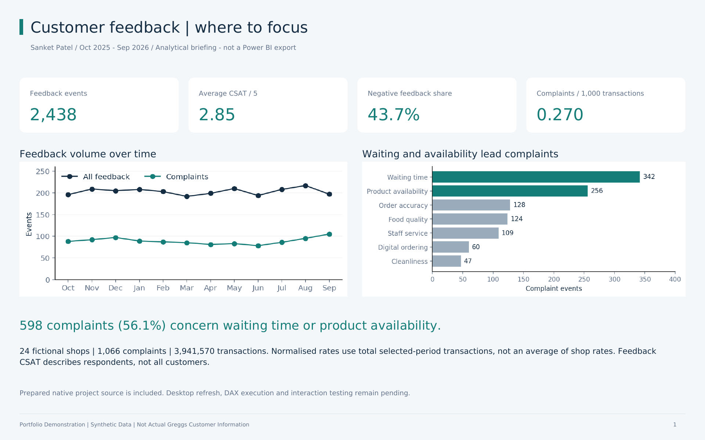
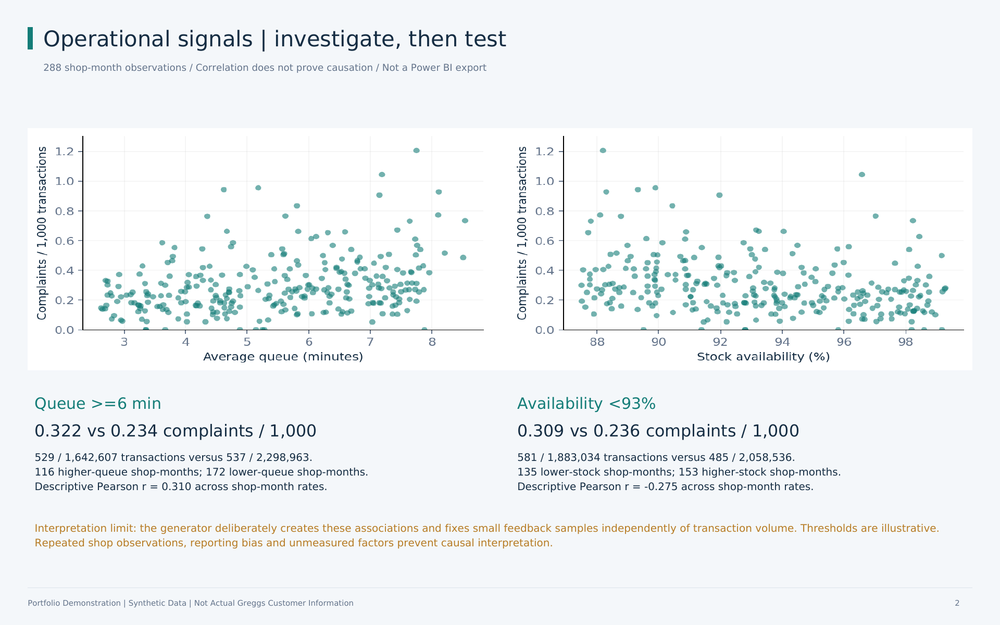
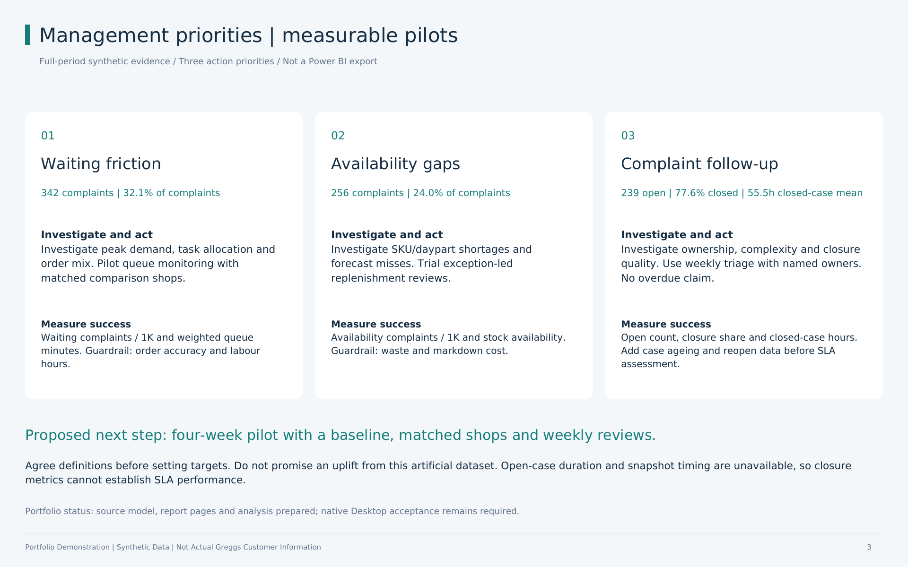

# Customer Feedback & Operational Insights

**Sanket Patel | Quantitative analysis meets frontline retail operations**

> **Portfolio Demonstration | Synthetic Data | Not Actual Greggs Customer Information**
>
> Independent portfolio exercise for a fictional UK bakery. No customer records, internal operational data or official endorsement.



## What is complete?

| Deliverable | Status |
|---|---|
| Original synthetic CSVs | Preserved byte-for-byte; 425 independent data/arithmetic checks pass |
| Native Power BI Project | Three editable PBIR pages, five-table TMSL model, five relationships, 21 DAX measures, 42 visual definitions; source schemas checked |
| Working PBIX | **Not created: Power BI Desktop was unavailable** |
| Native screenshots / Power BI PDF export | **Not created**; analytical briefing and clearly labelled PNGs provided instead |
| Analytical PDF, executive summary, script, email draft, technical documentation | Complete; email not sent |
| Desktop refresh, DAX execution and visual interactions | **Pending**; explicit acceptance checklist included |

The native project is editable source, not a promise of a tested runtime report. Schema validation cannot prove DAX execution, rendering, slicer behaviour or successful refresh.

## Start here

1. **Review the findings:** [three-page analytical briefing](insights/dashboard_analytical_briefing.pdf) and [one-page executive summary](insights/executive_summary.pdf).
2. **Finish the native report:** download/extract this repository, open `dashboard/CustomerFeedback/CustomerFeedback.pbip`, set `pDataFolder` to the extracted `data` folder, and Refresh in Windows Power BI Desktop. Follow the [short build and acceptance checklist](dashboard/BUILD_IN_POWER_BI.md) before saving a PBIX.
3. **Explore the existing browser demonstration:** open [interactive_preview.html](dashboard/interactive_preview.html) from the downloaded repository. This is a separate HTML demonstration, not Power BI.
4. **Prepare the conversation:** [two-minute walkthrough](insights/presentation_script.md), [email draft](insights/email_to_anna.md) and [hiring-manager review](insights/HIRING_MANAGER_REVIEW.md).

## Scenario and findings

Period: October 2025-September 2026; 24 fictional shops and 288 shop-month operational observations.

| KPI | Independently calculated result |
|---|---:|
| Feedback events | 2,438 |
| Complaints | 1,066 |
| Average feedback CSAT | 2.85 / 5 |
| Negative feedback share | 43.7% |
| Transactions | 3,941,570 |
| Complaints per 1,000 transactions | 0.270 |
| Open complaints | 239 |
| Complaint closure share | 77.6% |

Waiting time (342) and availability (256) account for 56.1% of complaints. Higher-queue shop-months show 0.322 complaints/1K versus 0.234; lower-availability shop-months show 0.309 versus 0.236. Recommendations cover queue monitoring, replenishment exceptions and complaint follow-up, with KPIs and guardrails.

These relationships are deliberately programmed into the generator. Feedback volume is a small sample generated independently of transaction volume. Neither correlation nor the apparent differences establish causation or describe Greggs performance.

## Report design

- **Executive overview:** four KPIs, monthly trends, complaint themes, regional rate comparison and shop drill-through entry.
- **Operational analysis:** queue/stock scatter plots, region-month matrix, complaint-rate trend, categories, tooltips and shop detail; also the drill-through destination.
- **Management recommendations:** three evidence/action/KPI panels plus closure metrics. Narrative evidence uses the full period; cards follow filters.

Month and region slicers are defined as synced. Conditional font colour and shop drill-through are authored in source but require Desktop interaction tests. [Page specification](dashboard/REPORT_SPEC.md).




## Model and validation

DimShop and **DimMonth** filter both facts with single-direction 1:* relationships. DimDate filters daily feedback only. Daily date filters intentionally blank operational rates because daily transaction exposure is unavailable. Category selection does not shrink the transaction denominator. Queue and stock use transaction-weighted averages.

This update also fixes the original browser preview's incorrect region-month segment matching (now exact shop-month) and rates previously rounded to integers.

```bash
python scripts/validate_project.py
node scripts/check_data.js
node scripts/check_preview.js
python scripts/build_project.py
# Optional dependencies for source schemas and PDFs:
python -m pip install -r scripts/requirements.txt
python scripts/validate_native_source.py
python scripts/build_briefing.py
```

`build_project.py` regenerates native source from M files and `scripts/measures.json`; it also updates the DAX listing. `update_preview.py` regenerates embedded preview data from the source CSVs. Run the PDF builder on Linux with DejaVu Sans installed. Do not regenerate source datasets unless intentionally resetting the deterministic scenario; this update leaves them untouched.

- [Technical documentation and audit](dashboard/TECHNICAL_DOCUMENTATION.md)
- [Data/arithmetic results and source hashes](validation/results.json)
- [117 region/month expected-result combinations](validation/expected_slices.csv)
- [Native source-schema and binding checks](validation/native_source_checks.json)
- [DAX acceptance queries](dax/validation_queries.dax)
- [Exact changed-file manifest](validation/CHANGE_MANIFEST.md)

## Repository layout

| Folder | Contents |
|---|---|
| data | Original datasets and dictionary |
| dashboard | Native project, model/report specifications, Desktop checklist, theme, preserved HTML preview |
| powerquery / dax | Import transformations, measures and Desktop validation queries |
| scripts | Reproducible analysis, project generation, preview checks and PDF builder |
| screenshots | Original SVG designs and analytical PDF renders; provenance clearly labelled |
| insights | Briefing, summary, demonstration script, email draft and hiring review |
| validation | Check results, expected KPI slices, source hashes and change manifest |

**Hiring-manager assessment:** useful evidence of quantitative reasoning, data-model design and operational interpretation. The main remaining weakness is the lack of a tested native Desktop demonstration. Complete the acceptance checklist before describing the project as a finished Power BI dashboard.
