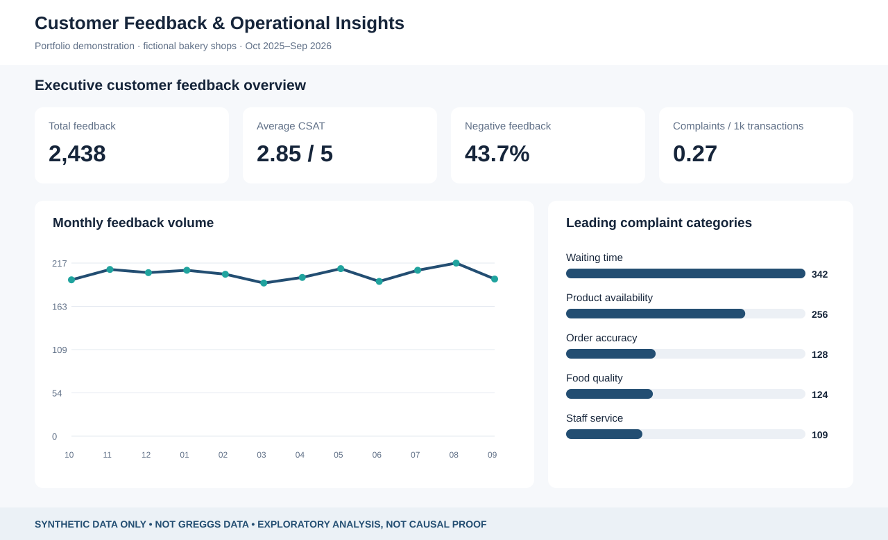
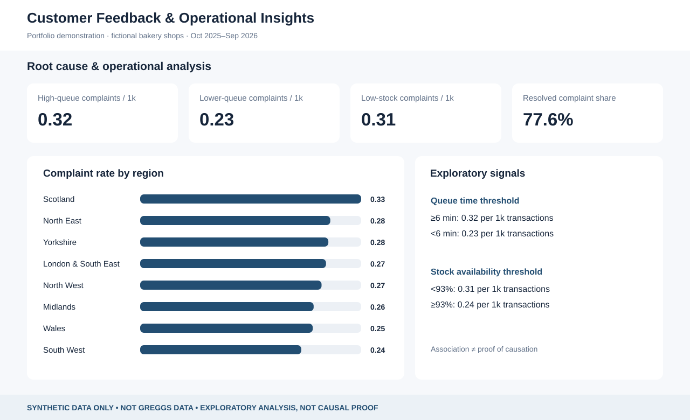
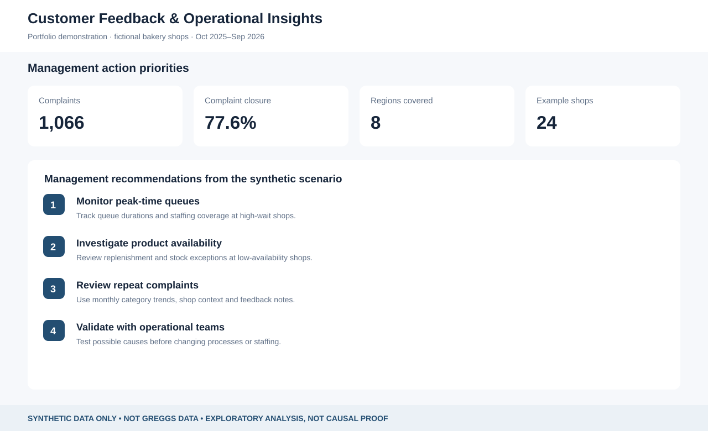

# Customer Feedback & Operational Insights — Power BI Portfolio

> **SYNTHETIC DATA ONLY.** Independent learning/portfolio exercise for a fictional UK bakery retail business. **Not real Greggs customer feedback, internal operations, sales data or an endorsed company report.**

An end-to-end demonstration of how customer feedback can become useful management insight, designed to showcase transferable retail knowledge, numerical analysis, data modelling and Power BI practice.

## Project at a glance

| Metric | Checked-in sample |
|---|---:|
| Period | October 2025 – September 2026 |
| Fictional shops | 24 |
| Feedback events | 2,438 |
| Shop-month operational records | 288 |
| Complaints | 1,066 |
| Average CSAT | 2.85/5 |
| Complaints per 1,000 transactions | 0.27 |

## Files

| Location | Contents |
|---|---|
| [`data/`](data/) | Fictional feedback, shop dimension and operations CSVs plus a data dictionary |
| [`scripts/`](scripts/) | Deterministic CSV generator and row/relationship validation |
| [`powerquery/`](powerquery/) | Power Query M import/typing queries |
| [`dax/`](dax/) | Business KPI and time intelligence measures |
| [`dashboard/`](dashboard/) | [Interactive browser preview](dashboard/interactive_preview.html), [Power BI Desktop instructions](dashboard/BUILD_IN_POWER_BI.md), model specifications |
| [`screenshots/`](screenshots/) | Three **illustrative SVG dashboard previews** (not screenshots exported from Power BI) |
| [`insights/`](insights/) | Executive summary, presentation script and draft outreach email |

## Explore the portfolio now

1. **Download the repository** using GitHub's **Code → Download ZIP**.
2. Extract and double-click **`dashboard/interactive_preview.html`** to explore region/month filters and three dashboard views. It works locally without internet or an account.
3. Read **[`insights/executive_summary.md`](insights/executive_summary.md)** for evidence-led interpretations and caveats.
4. If you want native Power BI, follow **[`dashboard/BUILD_IN_POWER_BI.md`](dashboard/BUILD_IN_POWER_BI.md)**. It explains exactly how to create and validate a 3-page report from the prepared sources.
5. Recreate the sample CSVs using **`node scripts/generate_data.js`** (Node 18+), then check them using **`node scripts/check_data.js`**.

### Dashboard page previews

**1. Executive overview**

**2. Root cause analysis**

**3. Recommendations**

## Analytical methods

- Star schema: `DimShop` and `DimDate` filter `FactFeedback` and `FactOperations`.
- DAX measures for negative feedback, average CSAT, complaints per 1,000 transactions, resolution and month-on-month trend.
- Normalised rates to account for differences in fictional shop traffic.
- Exploratory segmentation of queue times and product availability; no causal claims.

## Native PBIX status

**Not included / not yet tested.** Power BI Desktop is required to author and save a real `.pbix` file. The interactive HTML is a separate demonstration, and the SVGs are illustrations, not Power BI exports. The [native build instructions](dashboard/BUILD_IN_POWER_BI.md) and complete DAX/M inputs are provided so this project can be turned into a working PBIX without inventing one.

## Responsible use

This project must never incorporate non-public company records or personal customer data. Its generated relationships are artificial and should not be mistaken for findings about a real retailer. Neither Greggs nor any other employer is represented as sponsoring, approving or providing data for this exercise.

**Safety / integrity:** This is a wholly fictional UK bakery dataset generated for learning. It contains no Greggs systems data, real feedback, customer information, internal sales or operational records. It does not imply Greggs endorsement. All causal interpretations require real-world validation.
